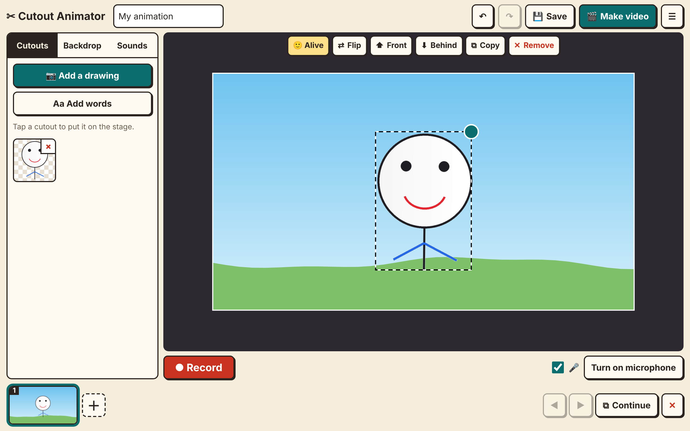

# Cutout Animator

**Open it here: <https://evandevon.github.io/cutout-animator/>**

Make an animation from your own drawings. Photograph a drawing, cut it out, arrange the cutouts on a stage, then press Record and tell the story while dragging them around. It works with a mouse or a touch screen, on phones, tablets, computers and large classroom screens.

It runs entirely in the browser. Photos and recordings stay on the device: nothing is uploaded.

## Using it

1. Go to <https://evandevon.github.io/cutout-animator/>.
2. **Add a drawing.** Take a photo, choose a picture or paste one. White paper is removed automatically. Tidy up with Draw around, Erase, Bring back and Tap to remove.
3. **Set the scene.** Choose a backdrop, background sound and music, and place your cutouts. Tap a cutout and choose **Alive** for people and creatures, so they sway a little instead of standing frozen. Leave objects as **Object**. Park cutouts in the dark area outside the frame so they can walk on later.
4. **Check the microphone.** The meter beside the Record button shows your volume, and the dropdown chooses a microphone if there's more than one.
5. **Record.** Your voice, the chosen sounds and every movement are recorded. Drag with a finger or the mouse. On a touch screen, several fingers can move different cutouts at once, and pinching resizes and turns a cutout.
6. **Teach a move (optional).** Tap a cutout, press Teach a move, drag it and let go. It repeats that move during recording. Grab it and it follows you, then glides back to where you grabbed it and carries on.
7. **Sound effects (optional).** In the Sounds tab, tick sounds to get big buttons under the stage, and tap them while recording.
8. **Add more.** Plays the scene back so you can move another cutout or add more voice.
9. Use the **＋** after the last scene to add another scene.
10. **Make video** joins the scenes into a video. **Save** downloads a `.cutz` project file that can be reopened and edited from the ☰ menu.

Work also autosaves on the device and is offered back next time the page opens.

## Templates for a whole class

1. Print the [A4](templates/cutout-template-A4.pdf) or [A3](templates/cutout-template-A3.pdf) template. Each sheet has a background box, four character boxes, a script area and sound tickboxes.
2. Students fill them in. Dark pens and bright colours work best.
3. Scan the sheets, then in the ☰ menu choose **Add filled-in templates**. Select JPGs or PDFs with one sheet per page, or use the webcam. Sheets can be crooked or upside down, as long as all four corner squares show.
4. Check the results, tap a cutout to fix it, and press **Add scenes**. Each sheet becomes one scene. The handwritten script shows on screen during recording.

To change the sheet, edit `tools/make_templates.py` and the matching numbers at the top of `template.js`.

## Project files

A `.cutz` file is a zip holding `project.json` (scenes, layouts and recorded movement) and `assets/` (cutouts, backdrops and audio). Pictures and sounds travel inside the file, so it opens on any device.

## How recording works

The app records movement data and audio, not screen video. Toolbars stay out of the picture, it works on iPads, and a recorded scene stays editable: change its backdrop, sounds or volumes, add to it, or redo it. The video is rendered from that data on export.

## Browser notes

- Use the HTTPS address above. Camera and microphone don't work from a `file://` page.
- Video comes out as MP4 where the browser can encode it directly. Otherwise the scene plays through once in real time to record it, which may give WebM on some browsers.
- Headphones give the cleanest voice recording, because the microphone can't pick up the music.

## Credits

Paper removal is adapted from Classroom Aquarium. Sound effects come from the Frame by Frame library. Background sounds and music are generated in code (`audio.js`). Uses [JSZip](https://stuk.github.io/jszip/) and [mp4-muxer](https://github.com/Vanilagy/mp4-muxer) (MIT) and [PDF.js](https://mozilla.github.io/pdf.js/) (Apache 2.0), included in `vendor/`.
